<div align="center">


# Treeline

**Git Graph, rebuilt for how you work today: feature branches, stacked PRs, worktrees and Claude Code.**
For VS Code and Cursor.

[](https://marketplace.visualstudio.com/items?itemName=epavanello.treeline)
[](https://open-vsx.org/extension/epavanello/treeline)
[](LICENSE)

[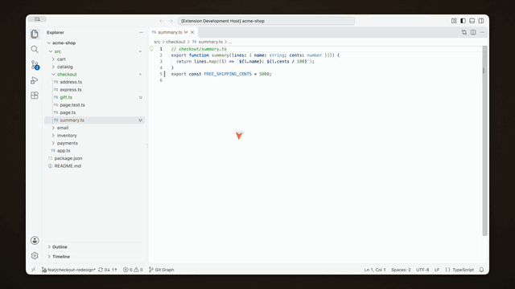](https://youtu.be/eXORu_KgFKw)

▶ **[Watch the demo, with sound](https://youtu.be/eXORu_KgFKw)**

[Compare](#-your-branch-vs-main) · [Review](#-review-before-the-pr-does) · [Worktrees](#%EF%B8%8F-worktrees-at-a-glance) ·
[Stacks & PRs](#-stacked-pull-requests) · [Cleanup](#-clean-up-in-one-go) · [Claude Code](#-claude-code-built-in)

</div>

## 🌿 Your branch vs main

**↑ahead ↓behind, always on top, and they're filters.** One click shows just your branch's commits.
Commits that landed through "Rebase and merge" or a cherry-pick count as merged, not as bogus ↑↓.

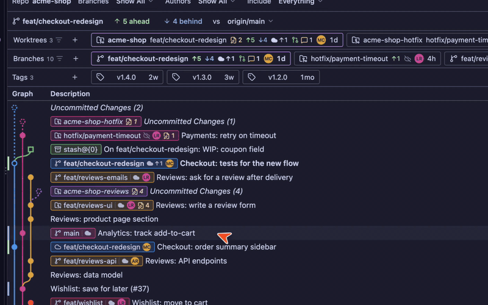

## 🔍 Review before the PR does

**Every commit, readable.** Message, author, the branches on it, a copyable hash, its parents one click away.

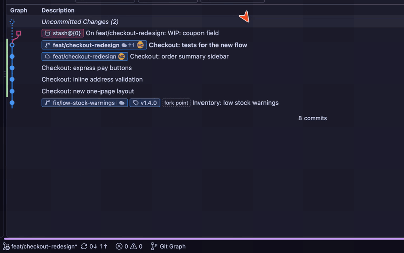

**Inline diffs, in your editor's colors.** Every change on one page, like a pull request, highlighted
with your own theme and grammars. **Diff** shows the whole branch since the fork, uncommitted work included,
and diffs open on your real files, so Go to Definition just works.

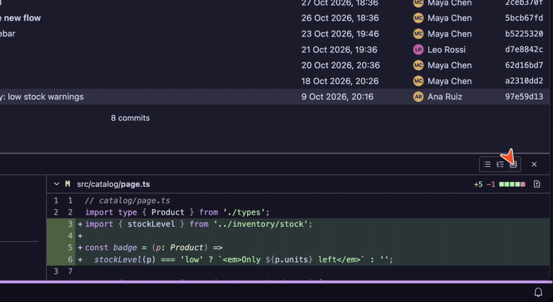

## 🗂️ Worktrees at a glance

**One chip per worktree:** its branch, ↑↓ vs main, its uncommitted files on hover, its own row in the graph.
Create one from any branch with **+**, open it, or bring its branch back to the main folder.

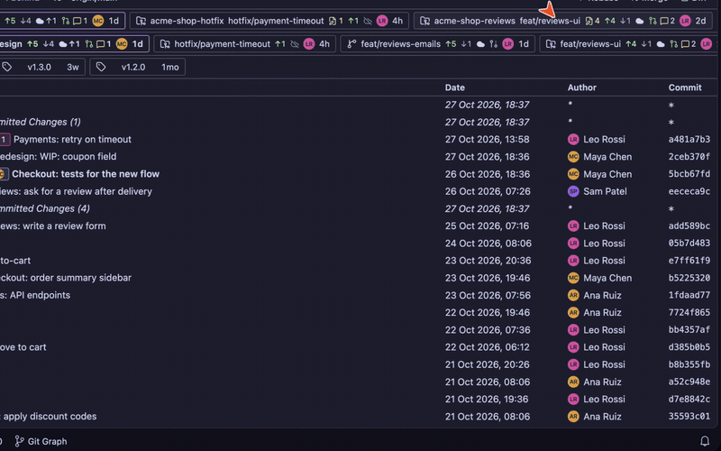

## 🥞 Stacked pull requests

**See a stack as one thing.** Right-click a branch → Graph Filter: it with main, with the branches built
on it, or its whole stack.

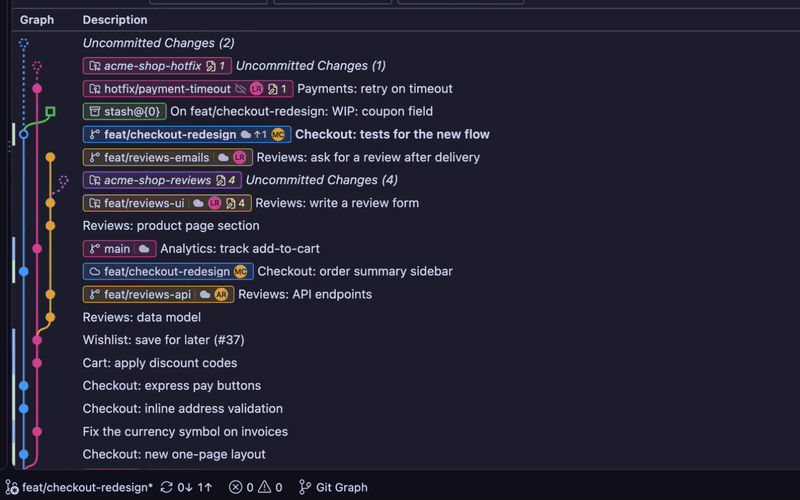

**Pull requests where you look.** State, reviewers and their verdicts, open conversations and checks on
every branch, through your `gh` CLI or the editor's GitHub account. Every branch shows its owner.

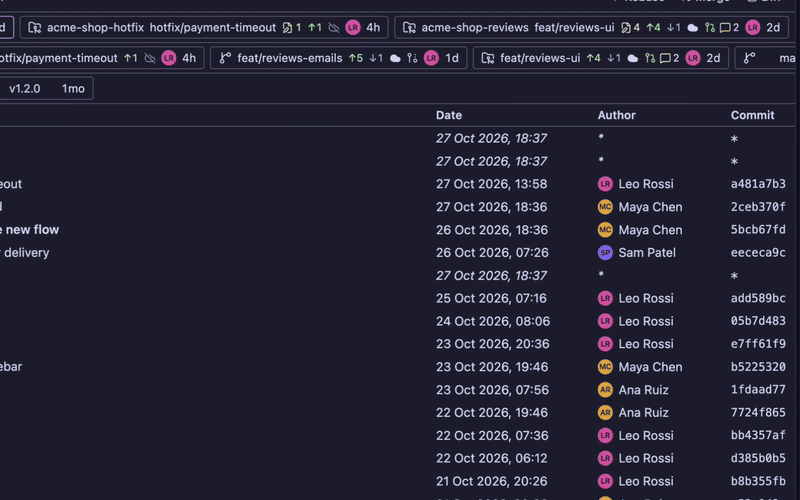

## 🧹 Clean up in one go

**Filter to merged, gone or stale branches, then delete them all** with one confirmation that says what
would be lost. Rebased, cherry-picked and squash-merged branches count as merged.

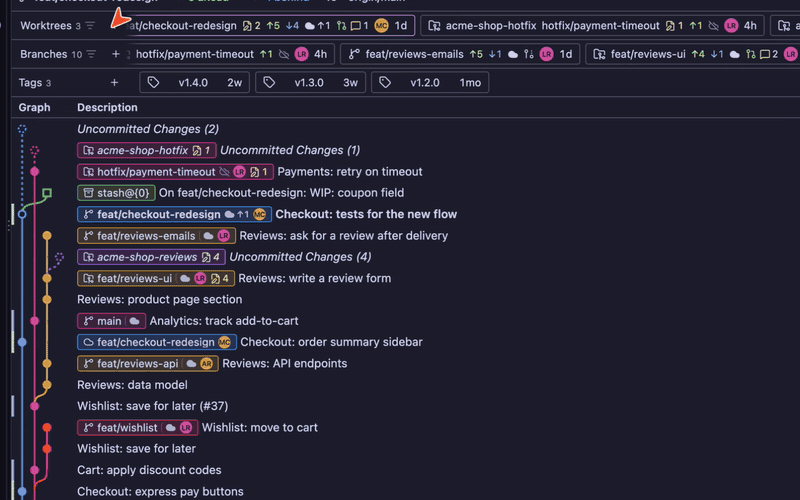

## ✨ Claude Code, built in

**Sessions per branch and worktree.** The Claude Code sessions that worked on a branch show on its card;
its menu resumes them, in the desktop app or a terminal.

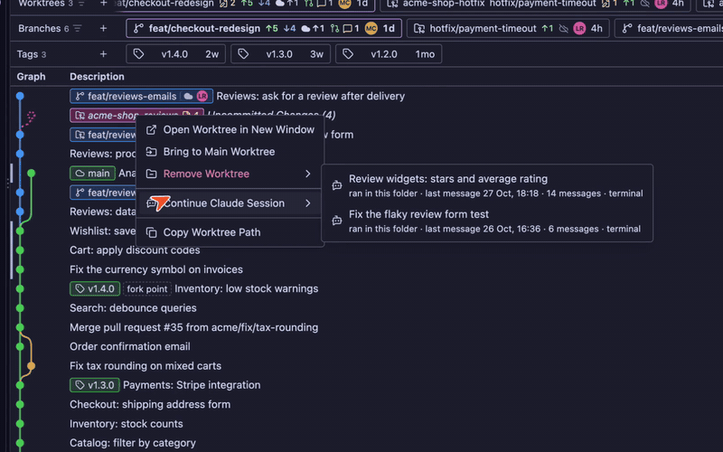

**Summarize any diff.** Four lines on what a commit, or your uncommitted work, does. Claude sees only
the diff: no project files, settings or tools.

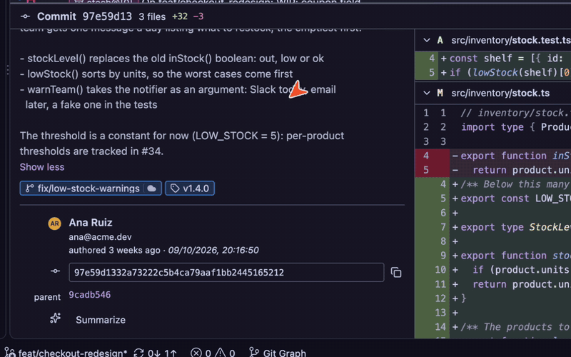

**Commit messages in your repository's style,** from ✨ in the Source Control title bar.

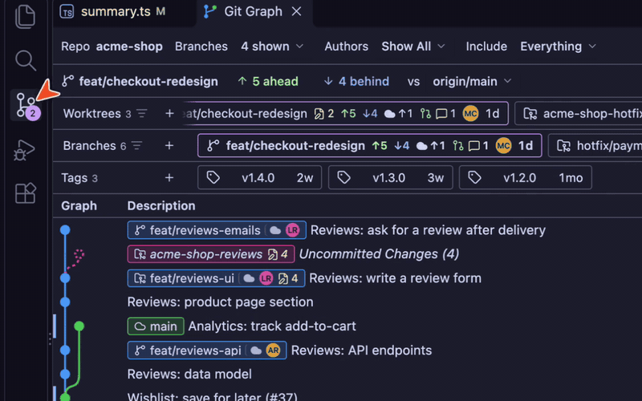

## 📜 And everything you loved in Git Graph

Infinite history · author and branch filters · find · compare any two commits · resizable columns ·
checkout, merge, rebase, cherry-pick, revert, reset, tag, push, pull, stash. Treeline asks only when
something would be lost, and every button explains itself on hover.

## Install

Search **Treeline** in the Extensions view of VS Code, Cursor, VSCodium or Windsurf. It's on the
[VS Code Marketplace](https://marketplace.visualstudio.com/items?itemName=epavanello.treeline) and on
[Open VSX](https://open-vsx.org/extension/epavanello/treeline), and every release also attaches the `.vsix`
to [GitHub Releases](https://github.com/epavanello/treeline/releases/latest).

Then run **Treeline: View Git Graph**, or click **Git Graph** in the status bar. The Claude features need
[Claude Code](https://claude.com/claude-code) (`claude` on your PATH); commit messages fall back to any
model your editor provides.

## Develop

```bash
pnpm install
pnpm dev        # watch the extension and the webview; press F5 in VS Code to launch it
pnpm test       # git layer against real temporary repos + graph layout
pnpm e2e        # the extension inside a real VS Code (actions, diffs, worktrees, commit messages)
pnpm --filter @treeline/webview dev:browser   # the UI in a browser with a mocked host
```

The architecture, conventions and roadmap live in [AGENTS.md](AGENTS.md), written for humans and coding
agents alike.

## Credits

Inspired by [Git Graph](https://github.com/mhutchie/vscode-git-graph) by Michael Hutchison (unmaintained
since 2021). Treeline is an independent, from-scratch reimplementation and shares no code with it.

## License

[MIT](LICENSE) © Emanuele Pavanello
