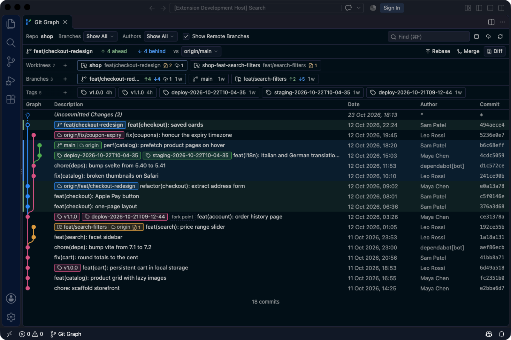
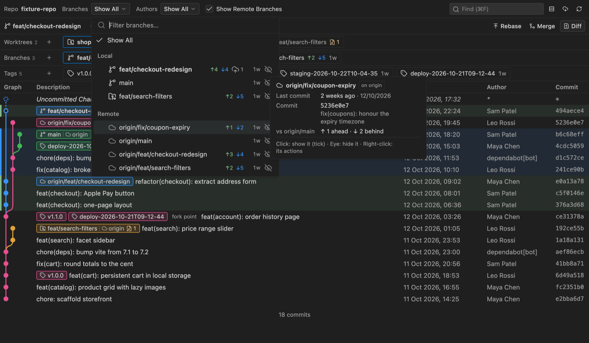
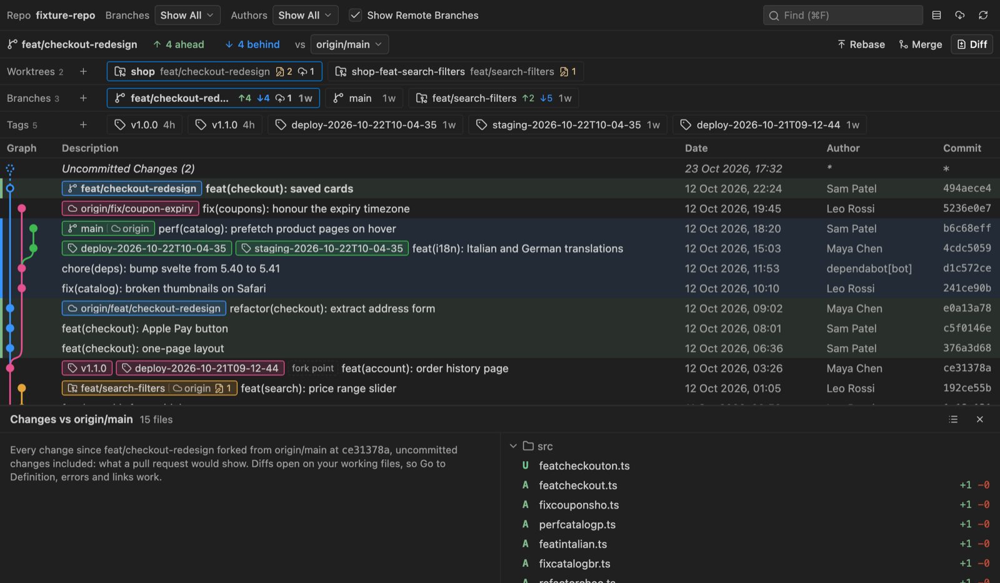

<div align="center">


# Treeline

**Git Graph, rebuilt for how you work today: feature branches, rebased PRs, worktrees.**
For VS Code and Cursor.

[](https://marketplace.visualstudio.com/items?itemName=epavanello.treeline)
[](https://open-vsx.org/extension/epavanello/treeline)
[](LICENSE)

[](https://youtu.be/tYY95Xhoqss)

▶ **[Watch the 1-minute demo, with sound](https://youtu.be/tYY95Xhoqss)**

</div>

## Why Treeline

|     |                                                                                                                                                                                                                                                                                                    |
| --- | -------------------------------------------------------------------------------------------------------------------------------------------------------------------------------------------------------------------------------------------------------------------------------------------------- |
| 🌿  | **Your branch vs main, always on top.** ↑ahead ↓behind are filters: one click shows just those commits. Commits that landed through "Rebase and merge" or a cherry-pick count as merged, and a rewritten history gets a warning instead of thousands of bogus ↑↓.                                  |
| 📋  | **Review before the PR does.** **Diff** lists every file changed since the fork, uncommitted work included, as a list or a folder tree. Diffs open on your real files, so Go to Definition, errors and links just work.                                                                            |
| 🗂️  | **Worktrees, branches and tags at a glance.** One row each, pinned under the compare bar: status, ahead/behind main, what to push or pull. Hover for the full card, click to jump to the commit, **+** to create (worktree picker, next semver tag).                                               |
| 🎯  | **See only what matters.** Show only some branches, or hide the noisy ones, from the branch dropdown or any branch's right-click menu. Local and remote branches, with their age and state, in one searchable list.                                                                                |
| 🔀  | **Pull requests where you look.** Each branch's card shows its pull requests: state, reviewers and their verdicts, unresolved conversations, checks. Through your signed-in gh CLI, or your editor's GitHub account.                                                                               |
| 🧹  | **Clean up in one click.** Filter the branch and worktree rows to yours, merged ones (rebased copies count), ones deleted on the remote or untouched for a month, then delete them all (local and remote copies) with one confirmation that says what would be lost. Every branch shows its owner. |
| ✨  | **Commit messages by Claude.** Your local [Claude Code](https://claude.com/claude-code) CLI (or any model your editor provides) writes the message in your repository's style.                                                                                                                     |
| 🙅  | **Fewer dialogs, no guessing.** Treeline asks only when something would be lost. Every button and menu item explains itself on hover, and whatever is running shows a spinner.                                                                                                                     |
| 📜  | **Everything you loved in Git Graph.** Infinite history, author filter, find, compare any two commits, resizable columns, and menus for checkout, merge, rebase, cherry-pick, revert, reset, tag, push, pull, stash…                                                                               |



<table>
  <tr>
    <td></td>
    <td></td>
  </tr>
  <tr>
    <td align="center"><sub>Every branch, its state and its card</sub></td>
    <td align="center"><sub>Review the whole branch; a worktree's card</sub></td>
  </tr>
</table>

## Install

Search **Treeline** in the Extensions view of VS Code, Cursor, VSCodium or Windsurf. It's on the
[VS Code Marketplace](https://marketplace.visualstudio.com/items?itemName=epavanello.treeline) and on
[Open VSX](https://open-vsx.org/extension/epavanello/treeline), and every release also attaches the `.vsix`
to [GitHub Releases](https://github.com/epavanello/treeline/releases/latest).

Then run **Treeline: View Git Graph**, or click **Git Graph** in the status bar.

## Develop

```bash
pnpm install
pnpm dev        # watch the extension and the webview; press F5 in VS Code to launch it
pnpm test       # git layer against real temporary repos + graph layout
pnpm e2e        # the extension inside a real VS Code (actions, diffs, worktrees, commit messages)
pnpm --filter @treeline/webview dev:browser   # the UI in a browser with a mocked host
```

The architecture, conventions and roadmap live in [AGENTS.md](AGENTS.md), written for humans and coding
agents alike.

## Credits

Inspired by [Git Graph](https://github.com/mhutchie/vscode-git-graph) by Michael Hutchison (unmaintained
since 2021). Treeline is an independent, from-scratch reimplementation and shares no code with it.

## License

[MIT](LICENSE) © Emanuele Pavanello
